<picture><source media="(prefers-color-scheme: dark)" srcset="https://raw.githubusercontent.com/NoahCherel/NoahCherel/HEAD/assets/banner-dark.svg"></picture>

<a href="https://www.linkedin.com/in/noahcherel/"><picture><source media="(prefers-color-scheme: dark)" srcset="https://raw.githubusercontent.com/NoahCherel/NoahCherel/HEAD/assets/btn-linkedin-dark.svg"></picture></a>&nbsp;
<a href="https://discord.com/users/351471515809742852"><picture><source media="(prefers-color-scheme: dark)" srcset="https://raw.githubusercontent.com/NoahCherel/NoahCherel/HEAD/assets/btn-discord-dark.svg"></picture></a>&nbsp;
<a href="mailto:noahcherel@gmail.com"><picture><source media="(prefers-color-scheme: dark)" srcset="https://raw.githubusercontent.com/NoahCherel/NoahCherel/HEAD/assets/btn-email-dark.svg"></picture></a>

### About me

- 📍 Based in **Nice, France**
- 🎓 Graduated from **Epitech**, and also studied at **Université Laval** in Québec
- 🛠️ Jack of all trades: low-level C, infrastructure, backends and interfaces
- 🔭 Lately building desktop and web apps with **Rust**, **Tauri** and **TypeScript**
- 💬 Always happy to talk about Linux, Docker, Kubernetes, or whatever you're building
- 📫 The best way to reach me is [LinkedIn](https://www.linkedin.com/in/noahcherel/) or [email](mailto:noahcherel@gmail.com)

 

### Toolbox

  <picture><source media="(prefers-color-scheme: dark)" srcset="https://skillicons.dev/icons?i=c%2Ccpp%2Crust%2Cgo%2Cts%2Cjs%2Cpython%2Cruby%2Ckotlin%2Creact%2Cnextjs%2Ctauri%2Cnodejs%2Cexpress%2Cmysql%2Cdocker%2Ckubernetes%2Cansible%2Cgithubactions%2Clinux%2Cgit%2Cvim&perline=11&theme=dark"></picture>

 

### GitHub stats

  <picture><source media="(prefers-color-scheme: dark)" srcset="https://github-readme-stats.vercel.app/api?username=NoahCherel&show_icons=true&rank_icon=github&bg_color=00000000&hide_border=true&title_color=4493F8&icon_color=4493F8&ring_color=4493F8&text_color=E6EDF3"></picture>
  <picture><source media="(prefers-color-scheme: dark)" srcset="https://github-readme-stats.vercel.app/api/top-langs/?username=NoahCherel&layout=compact&langs_count=8&hide=html%2Ccss&bg_color=00000000&hide_border=true&title_color=4493F8&icon_color=4493F8&ring_color=4493F8&text_color=E6EDF3"></picture>

  <picture><source media="(prefers-color-scheme: dark)" srcset="https://streak-stats.demolab.com/?user=NoahCherel&background=00000000&hide_border=true&ring=4493F8&fire=4493F8&currStreakLabel=4493F8&sideLabels=E6EDF3&currStreakNum=E6EDF3&sideNums=E6EDF3&dates=8B949E&stroke=8B949E40"></picture>

  <picture><source media="(prefers-color-scheme: dark)" srcset="https://github-readme-activity-graph.vercel.app/graph?username=NoahCherel&area=true&hide_border=true&radius=8&bg_color=00000000&custom_title=Contributions%20over%20the%20last%2030%20days&color=8B949E&title_color=E6EDF3&line=4493F8&point=E6EDF3&area_color=4493F8"></picture>

<b>Recent activity</b>

 

<!--START_SECTION:activity-->
<!--END_SECTION:activity-->

 

<picture><source media="(prefers-color-scheme: dark)" srcset="https://raw.githubusercontent.com/NoahCherel/NoahCherel/output/github-snake-dark.svg"></picture>
