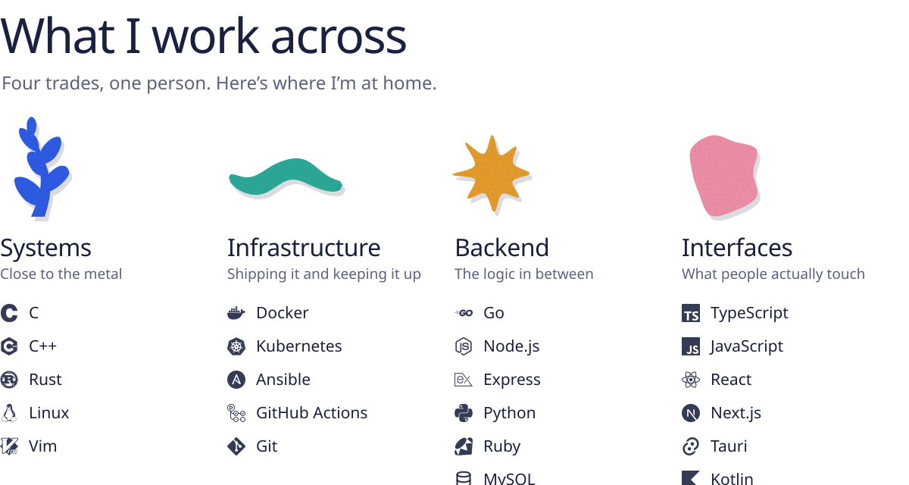

<!-- Visual assets live in /assets (dark + light). The snake comes from .github/workflows/snake.yml -->

<picture>
  <source media="(prefers-color-scheme: dark)" srcset="https://raw.githubusercontent.com/NoahCherel/NoahCherel/HEAD/assets/hero-dark.svg">
  
</picture>

  <a href="https://www.linkedin.com/in/noahcherel/"><picture><source media="(prefers-color-scheme: dark)" srcset="https://raw.githubusercontent.com/NoahCherel/NoahCherel/HEAD/assets/link-linkedin-dark.svg"></picture></a>&nbsp;&nbsp;&nbsp;
  <a href="https://discord.com/users/351471515809742852"><picture><source media="(prefers-color-scheme: dark)" srcset="https://raw.githubusercontent.com/NoahCherel/NoahCherel/HEAD/assets/link-discord-dark.svg"></picture></a>&nbsp;&nbsp;&nbsp;
  <a href="mailto:noahcherel@gmail.com"><picture><source media="(prefers-color-scheme: dark)" srcset="https://raw.githubusercontent.com/NoahCherel/NoahCherel/HEAD/assets/link-email-dark.svg"></picture></a>

I studied at Epitech and Université Laval in Québec, and I never picked just one lane. I like knowing how every layer works, from C and Linux up to Kubernetes clusters, backends and the interfaces people click on.

 

<picture>
  <source media="(prefers-color-scheme: dark)" srcset="https://raw.githubusercontent.com/NoahCherel/NoahCherel/HEAD/assets/trades-dark.svg">
  
</picture>

  

<picture>
  <source media="(prefers-color-scheme: dark)" srcset="https://raw.githubusercontent.com/NoahCherel/NoahCherel/HEAD/assets/activity-dark.svg">
  
</picture>

  <picture>
    <source media="(prefers-color-scheme: dark)" srcset="https://github-readme-stats.vercel.app/api?username=NoahCherel&show_icons=true&include_all_commits=true&rank_icon=github&hide_border=true&bg_color=00000000&title_color=5B86FF&icon_color=F2B24C&text_color=EDEFF7&ring_color=5B86FF">
    
  </picture>
  <picture>
    <source media="(prefers-color-scheme: dark)" srcset="https://streak-stats.demolab.com/?user=NoahCherel&hide_border=true&background=00000000&ring=5B86FF&fire=F2B24C&currStreakLabel=5B86FF&sideLabels=EDEFF7&currStreakNum=EDEFF7&sideNums=EDEFF7&dates=9AA3BF&stroke=9AA3BF40">
    
  </picture>

<picture>
  <source media="(prefers-color-scheme: dark)" srcset="https://raw.githubusercontent.com/NoahCherel/NoahCherel/output/github-snake-dark.svg">
  
</picture>

  

<picture>
  <source media="(prefers-color-scheme: dark)" srcset="https://raw.githubusercontent.com/NoahCherel/NoahCherel/HEAD/assets/footer-dark.svg">
  
</picture>
